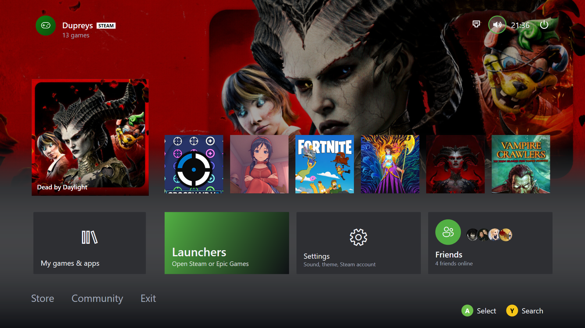
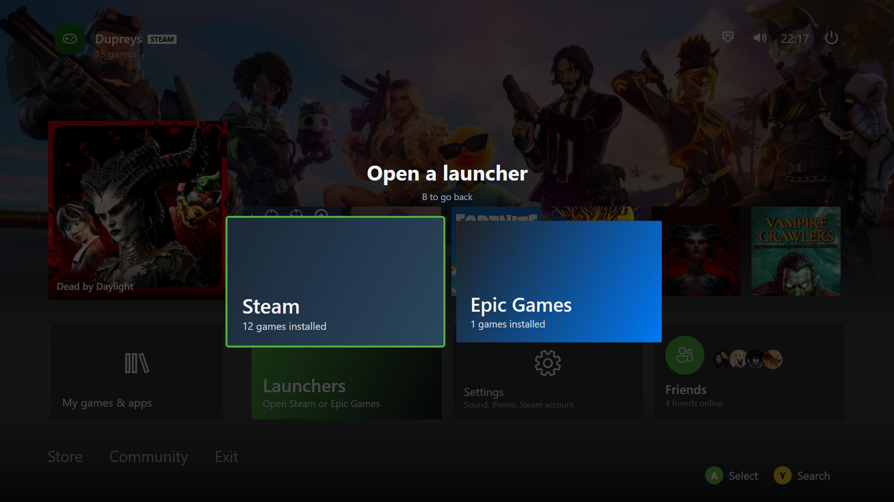

<p align="center"></p>

# LiteLauncher

Um launcher de jogos **leve** para Windows, com visual de console (inspirado no painel do Xbox) e feito para ser usado com **controle**, teclado ou mouse. Reúne seus jogos da **Steam** e da **Epic Games** em uma única tela.

Foi pensado para ser pequeno: não substitui o shell do Windows, não instala serviço em segundo plano e lê os arquivos que a própria Steam e a Epic já guardam no disco. Os jogos são abertos pelo cliente de cada loja, então overlay, nuvem de saves e DRM continuam funcionando.

Inspirado em [GamingConsoleMode](https://github.com/toonymak1993/GamingConsoleMode) e [Playnite](https://github.com/JosefNemec/Playnite).

## Capturas de tela

<p align="center"><br><sub>Tela inicial: fundo com a arte do jogo, jogos recentes, atalhos e barra superior</sub></p>

<p align="center"><br><sub>Launchers: Steam e Epic Games com a quantidade de jogos instalados</sub></p>

## Instalação

1. Abra a página de [**Releases**](../../releases) do projeto.
2. Baixe o `LiteLauncher-Setup.exe` (instalador) ou o `LiteLauncher-portable.zip` (sem instalar).
3. Execute. O Windows pode mostrar o aviso "O Windows protegeu seu computador", pois o programa não tem assinatura digital paga. Clique em **Mais informações → Executar assim mesmo**.

Os instaladores não exigem .NET instalado. Como gerar o instalador a partir do código: [docs/COMO-GERAR-O-EXE.pt-BR.md](docs/COMO-GERAR-O-EXE.pt-BR.md).

## Recursos

**Tela inicial estilo Xbox**
- Fundo que muda para a arte do jogo selecionado. Em Configurações você escolhe entre mostrar a imagem inteira (padrão) ou preencher a tela
- Cartão grande do último jogo jogado e fila dos jogos recentes
- Atalhos: *My games & apps*, *Launchers*, *Settings* e *Friends*; menu de texto (Store, Community, Exit)
- Menus de rede, volume e energia seguem o mesmo visual plano estilo Xbox One das demais telas
- Perfil, relógio e bateria (notebooks e portáteis) na barra superior; dicas de botões do controle no rodapé
- O jogo em destaque se atualiza sozinho quando você joga, instala ou desinstala algo

**Biblioteca ("My games & apps")**
- Lê os jogos instalados de **todas** as pastas de biblioteca da Steam e os jogos instalados da Epic
- Abas **Installed / Recent / Steam / Epic Games / Favourites**: `LB` e `RB` no controle (`PageUp` e `PageDown` no teclado) trocam de aba. *Recent* mostra só o que você já jogou
- **Ordenação**: `RT` no controle (ou `F2`, ou um clique no botão *Sort*) alterna entre Recentes, A–Z e Tamanho em disco; a escolha fica salva
- **Favoritos**: `X` no controle (ou `F`) marca ou desmarca o jogo
- **Capas automáticas**: se a Steam ainda não guardou a capa ou o fundo de um jogo, o LiteLauncher baixa a arte da loja da Steam e guarda em `%APPDATA%\LiteLauncher\covers` (a Epic não oferece arte pública; esses jogos continuam com a letra)
- Busca: comece a digitar, `Ctrl+F` ou `Y` no controle (abre também o teclado virtual do Windows)

**Tela de abertura do jogo (overlay)**
- Cartão com a capa e contagem de 3 segundos; `B` ou `Esc` cancela
- Durante o jogo ele vira a tela **Jogando agora**: tempo da sessão, botão **Back to game** (traz a janela do jogo para a frente) e o fechamento forçado. Quando você fecha o jogo, o LiteLauncher volta à frente na tela inicial
- **Fechamento forçado**: botão *Force close game* (aperte duas vezes para confirmar). Encerra os processos da pasta do jogo e volta ao início, útil quando o jogo trava ou não abre. Com o jogo em tela cheia, segure **Select + Start** por 1,5 s para trazer o launcher de volta. Jogos com anti-cheat podem recusar o encerramento; nesse caso use o Gerenciador de Tarefas

**Menu do jogo** (`Start` no controle, tecla Menu ou botão direito)
- Informações da loja (desenvolvedor, lançamento, jogadores online, gêneros, descrição), tempo jogado, última vez e tamanho em disco
- **Conquistas** (Steam): progresso com barra e lista completa (ícone, nome, descrição, data). Precisa estar logado na Steam, com "Detalhes do jogo" público. A Epic não oferece conquistas a outros programas
- **Manage**: renomear, escolher capa/fundo próprios, ou restaurar os originais (só muda no LiteLauncher)
- **SteamGridDB**: busca capas, fundos e logos da comunidade (precisa de uma chave gratuita)

**Amigos (Steam)**
- Amigos online, com os que estão jogando primeiro e o nome do jogo; `A` abre a conversa no cliente da Steam
- Precisa de login na Steam e de uma chave da Steam Web API (gratuita)

**Barra superior: rede, volume e energia**
- `Seta para cima` no controle leva à barra superior
- **Rede**: lista as redes Wi-Fi com sinal, conecta em redes salvas ou pede a senha com o teclado virtual. Usa o `netsh wlan` do Windows; o LiteLauncher não guarda senhas
- **Volume**: volume geral do Windows e mudo
- **Energia** (ou `Select` / `F9`): Suspender, Reiniciar e Desligar, com confirmação nos dois últimos

**Launchers**
- Mostra Steam e Epic com a quantidade de jogos instalados. Ao escolher, o cliente abre (Steam na biblioteca) e o LiteLauncher minimiza para ele aparecer

**Configurações**
- **Som**: volume do sistema e sons de navegação
- **Tema**: cor de destaque, cor de fundo, arte do jogo no fundo (mostrar imagem inteira ou preencher), escurecimento
- **Perfil**: nome, avatar pronto ou foto do seu PC (a Steam não é alterada)
- **Conta Steam**: login oficial pela Steam (OpenID) ou reutilizar a conta do cliente
- **Geral**: iniciar em tela cheia, **iniciar junto com o Windows**, verificar atualizações e reler a biblioteca

**Atualizações**
- Ao abrir (no máximo uma vez por dia) o LiteLauncher consulta a última versão publicada em Releases e avisa se houver uma nova; em Configurações → Geral o botão abre a página de download. Nada é baixado nem instalado sozinho. Funciona nas versões geradas pelo fluxo de Release do GitHub (o endereço do repositório e o número da versão entram no programa nessa hora); builds locais de desenvolvimento não consultam

**Entradas:** teclado, mouse e controles. Controle Xbox (e qualquer um que a Steam Input mostre como Xbox) funciona direto. **PlayStation (DualShock 4 / DualSense), Switch Pro e controles DirectInput genéricos** também são lidos pelo Windows, sem programa extra: `X`/Cruz seleciona, Círculo volta, Triângulo busca, Quadrado favorita, `Options` abre o menu do jogo, `Share`/`Create` abre a energia e `L1`/`R1`/`R2` trocam abas e ordenação (a numeração dos botões desses controles foi montada pela documentação e ainda não foi testada em todos os modelos; se algum botão estiver trocado, abra uma issue com o modelo). Direcional ou analógico esquerdo movem; `Start` abre o menu do jogo ou atualiza. `F11` alterna tela cheia; `--fullscreen` inicia assim.

Configurações ficam em `%APPDATA%\LiteLauncher\settings.json`. Se algo der errado, o launcher continua aberto e registra os detalhes em `%APPDATA%\LiteLauncher\crash.log`; envie esse arquivo ao relatar um problema. Suas chaves de API ficam nessa pasta, nunca no projeto.

## Sobre o "Entrar com a Steam"

Usa o login oficial da Steam (OpenID 2.0): o navegador abre `steamcommunity.com`, você entra normalmente (com Steam Guard), a Steam devolve a resposta a um ouvinte local temporário em `127.0.0.1`, o LiteLauncher pede à Steam para validá-la e só então guarda seu **SteamID64 público**. Senha e tokens nunca passam pelo programa. Perfis **privados** não expõem nome nem foto.

## Compilar e gerar o instalador

Requisitos: Windows 10/11, [.NET 8 SDK](https://dotnet.microsoft.com/download/dotnet/8.0) e, para o instalador, [Inno Setup 6](https://jrsoftware.org/isinfo.php).

```powershell
dotnet run --project src/LiteLauncher.App          # executar
dotnet test                                         # testes
powershell -ExecutionPolicy Bypass -File build\publish.ps1   # LiteLauncher.exe + instalador
```

O GitHub também gera o instalador sozinho: ao publicar uma tag como `v1.0.0`, o fluxo `.github/workflows/release.yml` compila, testa e anexa `LiteLauncher-Setup.exe` e o zip portátil à página de Releases. Passo a passo em [docs/COMO-GERAR-O-EXE.pt-BR.md](docs/COMO-GERAR-O-EXE.pt-BR.md).

**Modo Xbox do Windows 11 (MSIX)**: no Windows 11 24H2 ou superior, o LiteLauncher pode ser escolhido como app inicial em *Configurações > Jogos > Modo Xbox* usando um pacote MSIX com o recurso `windows.gamingApp`. A Microsoft só assina essa capacidade para parceiros, por isso o caminho é o modo desenvolvedor, o mesmo usado por projetos da comunidade como [Playnite-FSE-Launcher](https://github.com/leeson865/Playnite-FSE-Launcher) e [AnyFSE](https://github.com/ashpynov/AnyFSE):

```powershell
powershell -ExecutionPolicy Bypass -File build\publish.ps1
powershell -ExecutionPolicy Bypass -File packaging\build-msix.ps1   # precisa do SDK do Windows 11
powershell -ExecutionPolicy Bypass -File packaging\install-fse.ps1  # PowerShell como ADMINISTRADOR
```

`packaging\uninstall-fse.ps1` remove tudo. Não é um recurso oficial da Microsoft e uma atualização do Windows pode alterá-lo. A opção "Modo Xbox" do instalador comum é diferente: só liga a chave do Windows, com o app Xbox como tela inicial.

## Estrutura do projeto

```
src/LiteLauncher.Core        Biblioteca portátil (compila e testa também em Linux/macOS)
  Game.cs, IGameProvider.cs    Modelo e interface que cada loja implementa
  Settings/                    Configurações (arquivo JSON gravado com segurança)
  Steam/                       Leitor de .vdf/.acf, biblioteca, capas, conta, OpenID, amigos
  Epic/                        Leitor dos manifestos da Epic
  Achievements.cs              Conquistas (página da comunidade e Web API)
  ProcessScope.cs              Regras de segurança do fechamento forçado
src/LiteLauncher.App         Interface WPF
  MainWindow.*.cs              Início, biblioteca, filtros, overlay, menu do jogo, amigos, energia...
  GameProcessKiller.cs         Encerra os processos do jogo
  Gamepad.cs                   Leitura do controle (XInput)
tests/LiteLauncher.Core.Tests  Testes xunit
build/, installer/, packaging/ Scripts do .exe, instalador Inno Setup e MSIX
```

Para adicionar outra loja, implemente `IGameProvider` em `LiteLauncher.Core` e registre em `_providers` (`MainWindow.xaml.cs`).

## Roadmap

- [ ] Provedores GOG e Xbox / Game Pass
- [ ] Jogos da Steam não instalados
- [ ] Arte para jogos da Epic (via SteamGridDB)
- [ ] Perfis de controle e remapeamento de botões
- [ ] Instalar atualizações automaticamente (hoje o programa só avisa)
- [ ] Assinatura de código do instalador
- [x] Iniciar junto com o Windows
- [x] Aviso de atualização
- [x] Download de capas ausentes (Steam)
- [x] Ordenação e aba Recentes
- [x] Controles PlayStation, Switch e DirectInput

## Avisos

- Sem vínculo com Valve, Microsoft, Xbox ou Epic Games. Steam é marca da Valve Corporation. O visual é inspirado em painéis de console e não inclui arte ou recursos do Xbox.
- Jogos sem imagem no cache da Steam mostram uma letra no lugar da capa.

## Licença

Veja o arquivo [LICENSE](LICENSE).
