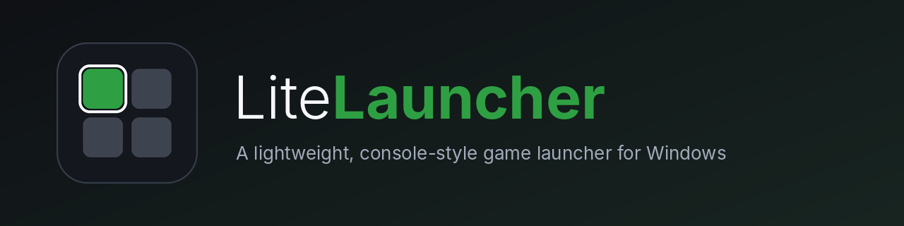

<p align="center"></p>

# LiteLauncher

A lightweight, console-style game launcher for Windows with an Xbox-dashboard look. First integration: your **Steam** library.

Inspired by [GamingConsoleMode](https://github.com/toonymak1993/GamingConsoleMode), but deliberately small:
no shell replacement, no background service, no Steam Web API key. It reads Steam's own files on disk and
launches games through the Steam client.

## Features (v0.2)

**Xbox-style home screen**
- Full-screen backdrop that cross-fades to the art of the game you have highlighted
- Big tile for the last game you played, a row of recent games next to it
- Bottom row: *My games & apps*, Steam, Settings and your account; text menu (Store, Community, Exit)
- Profile, clock and battery (laptops/handhelds) in the top bar, controller button hints bottom-right
- The whole layout is drawn on a 1280x720 canvas and scaled, so it looks the same at any window size

**Live updates**
- The featured game is always the one you played last, and it changes as you play: starting any Steam game
  (from this launcher, from Steam itself or from a shortcut) puts it in the big tile within a couple of seconds
- A file watcher on Steam's `steamapps` folders adds or removes games as they finish installing or are uninstalled
- Coming back to the launcher after a game refreshes the order; tiles are moved, not rebuilt, so your focus stays put
- The top bar shows "Playing <game>" while a game runs

**Launch overlay**
- Picking a game shows a full-screen card with its cover and a 3-second countdown; `B`/`Esc` cancels
- While the game runs the card stays behind it ("Playing now" + play time); when the game closes, LiteLauncher
  comes back to the front on the Home screen automatically

**Game menu** (`Start` on a controller, the Menu key, or right-click a game)
- Store info for the game: developer, release date, players online now, genres and description (Steam), plus your
  playtime, last played and size on disk
- **Achievements** (Steam): how many you have unlocked, with a progress bar. Uses your Steam Web API key when saved
  (Settings -> Integrations), otherwise the public community stats page. Needs Steam sign-in and your Steam
  "Game details" privacy set to Public. The **Achievements** button next to "More about the game" opens the full list
  (icon, name, description, unlock date; unlocked first). Epic does not expose achievements to other apps, so it says so.
- **Play**, **More about the game** (opens the game's page in Steam, or the Epic store) and **Manage**:
  rename the game, pick your own cover or background, or restore the originals. Only LiteLauncher changes.

**SteamGridDB** (game menu → Manage → SteamGridDB…)
- Browse community covers, backgrounds and logos for the game and apply one with `A`; a logo replaces the title in the game menu
- Needs your free SteamGridDB API key (Settings → Integrations)

**Friends** (home tile, replaces the account tile)
- Your Steam friends who are online, in-game first, with what they are playing; refreshes every minute
- `A` on a friend opens a chat with them in the Steam client; "Open Steam chat" opens the Steam friends window
- Needs Steam sign-in plus your free Steam Web API key (Settings → Integrations); your profile is still in Settings → Profile

**Epic Games Store**
- Installed Epic games appear next to Steam ones (read from the Epic launcher's install manifests) and launch through the Epic launcher
- Live tracking: installs/uninstalls show up automatically; starting an Epic game (from here or from Epic) is detected,
  moves it to the big tile and records last played + playtime (kept in settings.json, Epic stores neither locally)
- Home tile **Launchers** (replaces the Steam tile): pick Steam or the Epic Games Launcher to open it

**Top bar: network, volume and power**
- Press **D-pad Up** from the top row of any screen to reach the top bar (Power is selected first); Left/Right moves between
  the icons, `A` opens one, Down or `B` goes back to where you were
- **Network** icon (Wi-Fi / Ethernet / offline): lists nearby Wi-Fi networks with signal; `A` joins a saved network, or asks for
  the password (`A` opens the on-screen keyboard) for a new one (WPA2 or open networks). Also *Scan again*, *Disconnect Wi-Fi*
  and a shortcut to the Windows network settings. Uses Windows' own `netsh wlan`; nothing is stored by LiteLauncher
- **Volume** icon: system volume slider (Left/Right) and mute, same as in Settings
- **Power** icon, or `Select` on the controller (`F9` on the keyboard): **Sleep**, **Restart**, **Shut down**.
  Restart and shut down ask for confirmation first (Cancel is pre-selected); sleep runs straight away

**Library**
- Reads installed games from **all** Steam library folders; covers from Steam's local cache
- Search field for installed games: just start typing on this screen (or `Ctrl+F`)
- With a controller: `Y` opens the search **and the Windows on-screen keyboard** (touch keyboard, or the classic
  On-Screen Keyboard when the touch one can't be shown); `A` confirms and jumps to the results; `B` closes the
  search and the keyboard and takes you back. On the profile name field, `A` opens/closes the keyboard
- Launches via `steam://rungameid/<id>` (overlay, cloud saves and DRM keep working)

**Settings** (Home -> Settings)
- **Sound:** system volume and mute (Windows master volume), navigation sounds on/off + their volume
- **Theme:** accent colour, background colour, show/hide game art, background darkness (applies live)
- **Profile:** change the display name, pick one of 8 ready-made avatars, or a picture from your PC (square-cropped copy kept in `%APPDATA%\LiteLauncher`); Steam itself is not changed
- **Steam account:** sign in with Steam, or reuse the account already signed in to the Steam client
- **General:** start in fullscreen, rescan library

**Input:** keyboard, mouse and Xbox/XInput controller (D-pad/left stick, `A` select, `B` back, `Y` search, `Start` refresh).
`F11` toggles fullscreen, `--fullscreen` starts that way.

Settings are stored in `%APPDATA%\LiteLauncher\settings.json`.

If something unexpected goes wrong the launcher keeps running and writes the details to
`%APPDATA%\LiteLauncher\crash.log`; attach that file when reporting a bug.

## About "Sign in with Steam"

It uses Steam's official OpenID 2.0 login:

1. Your browser opens `steamcommunity.com`, where you sign in as usual (Steam Guard included).
2. Steam redirects back to a one-shot listener on `127.0.0.1` inside LiteLauncher.
3. LiteLauncher asks Steam to verify that response and only then saves your **public SteamID64**.
4. Name and avatar come from your public community profile.

Your password and tokens are never seen or stored. Limitation: a **private** Steam profile exposes no name or
picture; you still sign in, and the launcher shows a generic name. Sign-in identifies you but does not unlock
anything that Steam's Web API would need a key for (e.g. not-installed games), see the roadmap.

## Requirements

- Windows 10/11
- [.NET 8 SDK](https://dotnet.microsoft.com/download/dotnet/8.0) to build; .NET 8 Desktop Runtime to run

## Download

Installers are attached to each [GitHub Release](../../releases) (`LiteLauncher-Setup.exe`, or the portable zip). They are built
automatically by `.github/workflows/release.yml` when a version tag such as `v1.0.0` is pushed. Step by step (Portuguese):
[docs/COMO-GERAR-O-EXE.pt-BR.md](docs/COMO-GERAR-O-EXE.pt-BR.md).

## Build the .exe and the installer

On a Windows PC with the .NET 8 SDK (and, for the installer, [Inno Setup 6](https://jrsoftware.org/isinfo.php)):

```powershell
powershell -ExecutionPolicy Bypass -File build\publish.ps1
```

This runs the tests, writes a self-contained `publish\LiteLauncher.exe` (no .NET needed on the target PC) and, when Inno Setup
is installed, `dist\LiteLauncher-Setup.exe`. The installer is per-user (no administrator prompt) and offers: desktop shortcut,
start full screen at sign-in, and turning on Windows 11 **Xbox mode** (see below).

**LiteLauncher as the Xbox mode home app (MSIX).** Windows 11 24H2+ has *Settings > Gaming > Xbox mode*. Making LiteLauncher the
home app needs a package that declares the `windows.gamingApp` extension and the `Microsoft.appCategory.gamingHome` capability.
Microsoft only signs that capability for partners, so this uses the same developer-mode route as the community projects
([Playnite-FSE-Launcher](https://github.com/leeson865/Playnite-FSE-Launcher), [AnyFSE](https://github.com/ashpynov/AnyFSE)):

```powershell
powershell -ExecutionPolicy Bypass -File build\publish.ps1            # 1. build the exe
powershell -ExecutionPolicy Bypass -File packaging\build-msix.ps1     # 2. package + sign (needs the Windows 11 SDK)
powershell -ExecutionPolicy Bypass -File packaging\install-fse.ps1    # 3. install, from an ADMINISTRATOR PowerShell
```

Then pick LiteLauncher under *Settings > Gaming > Xbox mode*. `packaging\uninstall-fse.ps1` removes everything. The packaged app always
starts full screen and keeps using the normal `%APPDATA%\LiteLauncher` settings. Caveats: not Microsoft-supported; a Windows update can
change it; the installer script turns Developer Mode on only while installing. The plain installer's "Xbox mode" option is different:
it only turns Windows' switch on, with the Xbox app as home.

## Build and run

```powershell
dotnet run --project src/LiteLauncher.App
dotnet test
dotnet publish src/LiteLauncher.App -c Release -r win-x64 --self-contained false -p:PublishSingleFile=true -o publish
```

## Project layout

```
src/LiteLauncher.Core            Portable library (also builds/tests on Linux/macOS)
  Game.cs, IGameProvider.cs        Model and the interface every store implements
  Settings/                        AppSettings + SettingsStore (atomic JSON file)
  Steam/VdfParser.cs               Valve KeyValues (.vdf/.acf) parser
  Steam/SteamLocator.cs            Finds the Steam install folder
  Steam/SteamLibraryReader.cs      libraryfolders.vdf + appmanifest_*.acf -> games
  Steam/SteamArtwork.cs            Cached covers and hero backgrounds
  Steam/SteamAccount.cs            loginusers.vdf + public profile (name, avatar)
  Steam/SteamOpenId.cs             "Sign in through Steam" (OpenID 2.0)
  Steam/SteamProvider.cs           IGameProvider implementation, launches games
src/LiteLauncher.App             WPF UI
  Styles.xaml, App.xaml            Xbox-style control templates, theme tokens
  MainWindow.xaml(.cs)             Home, library, navigation, backdrop, input
  MainWindow.Settings.cs           Settings screen logic and Steam account UI
  ThemeManager.cs                  Applies colours live (DynamicResource)
  SoundEffects.cs, SystemVolume.cs Synthesised UI sounds; Windows master volume (Core Audio)
  Gamepad.cs                       XInput polling
tests/LiteLauncher.Core.Tests    xunit tests (parser, library, settings, account, OpenID)
```

## Adding another store

Implement `IGameProvider` in `LiteLauncher.Core` and add it to `_providers` in `MainWindow.xaml.cs`.

## Roadmap

- [ ] Not-installed Steam games (needs a Steam Web API key or the public games list)
- [ ] Cover download fallback when Steam hasn't cached an image yet
- [ ] Epic Games, GOG, Xbox / Game Pass providers
- [ ] Favourites, per-game details, on-screen keyboard for search
- [ ] Start with Windows

## Notes

- Not affiliated with Valve, Microsoft or Xbox. Steam is a trademark of Valve Corporation. The layout is
  inspired by console dashboards; no Xbox artwork or assets are included.
- Games without art in Steam's cache show a letter placeholder.

## Game overlay: force close and wallpaper

- While a game is starting or running, the overlay has a **Force close game** button. Press it twice (A / Enter) to end every process that runs from the game's install folder and go back to Home. If the game is in front of the launcher, hold **Select + Start** on the controller for 1.5 s to bring the overlay back. Games protected by anti-cheat may refuse to be closed; use Task Manager then.
- **Settings → Theme → Show the whole image** (on by default) shows wide game art uncropped, pinned to the top and fading into the background. Turn it off to fill the screen like before.
